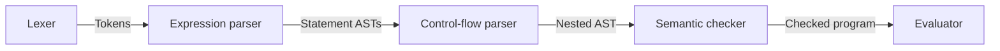

# Bang – A Minimalistic Array-Centric Scripting Language

> **Built for prototyping. No ceremony.**

**Bang** is a small scripting language built around expressive array operations, flexible function calls, and a readable Python interpreter. It supports destructuring, first-class functions, persistent closures, and records, with separate stages for **lexing → expression parsing → control-flow parsing → semantic analysis → evaluation**.

This repository contains the language's from-scratch reference implementation, examples, and correctness tests. Each stage is accessible on its own, making Bang a practical codebase for exploring how an interpreter works and extending it with new behavior.


---

## Table of Contents

1. [Motivation](#motivation)
2. [Key Language Features](#key-language-features)
3. [Architecture Overview](#architecture-overview)
4. [File / Module Guide](#file--module-guide)
5. [Getting Started](#getting-started)
6. [Running Bang Code](#running-bang-code)
7. [Examples!](#examples)
8. [Stabilized Behavior](#stabilized-behavior)
9. [Function Arguments](#function-arguments)
10. [Running the Test-Suite](#running-the-test-suite)
11. [Extending the Language](#extending-the-language)
12. [Project Roadmap](#project-roadmap)
13. [Contributing](#contributing)
14. [License](#license)

---

## Motivation

Bang explores how much useful behavior can fit into a small, approachable language. Arrays are central: you can combine them, operate on corresponding elements, destructure results, and pass a variable number of arguments as an array.

The interpreter is also part of the project. Parsing, checking, and execution live in separate modules, so you can follow a program from source text to runtime values and understand where each language rule is implemented.

## Key Language Features

* **Array-centric operators:** concatenate with `+`, remove matching elements with `-`, and perform element-wise `*`, `/`, and `//`, including singleton broadcasting. `[1,2] * 2` repeats each element and produces `[1,1,2,2]`.
* **Destructuring and compound assignment:** `[a,b] = [1,2]`, nested targets, and `+=`, `-=`, `*=`, `/=`.
* **Familiar expressions and control flow:** arithmetic, comparisons, membership with `in`, short-circuit `&&` and `||`, unary `!`, and `if`, `elif`, `else`, `for`, `while`, `break`, and `continue`.
* **Flexible function interfaces:** a variadic argument array, that array combined with named options, or a fixed list of declared parameters. Defaults evaluate per call.
* **First-class functions and persistent closures:** return functions, store them in containers or records, and preserve captured state across calls.
* **Records, sets, and dictionaries:** define record types with `data`, access fields with `.`, and construct sets and dictionaries with `set{...}` and `dict{...}`.
* **A compact builtin library:** `print`, `len`, `sum`, `min`, `max`, `sort`, `range`, `set`, and `dict`.
* **Checks at both stages:** semantic analysis validates bindings, known type information, and control-flow placement; runtime checks handle values that remain dynamic.

## Architecture Overview

A `.bang` file passes through five stages:



The expression parser uses shunting-yard parsing to resolve precedence and build expression trees. The control-flow parser organizes statements into blocks. Semantic analysis checks what can be established before execution, and the evaluator executes the resulting program with runtime validation.

## File / Module Guide

| Path | Responsibility |
|------|----------------|
| `bang/lexing/lexer.py` | Reads UTF-8 source and produces tokens with source locations. |
| `bang/lexing/lexer_tokens.py` | Defines token types, keywords, and symbols. |
| `bang/parsing/expression_parser.py` | Parses expressions, assignments, function declarations, and calls. |
| `bang/parsing/control_flow_parser.py` | Organizes statements into nested control-flow and function blocks. |
| `bang/parsing/parser_nodes.py` | Defines the AST nodes shared by later stages. |
| `bang/calling.py` | Shares argument-binding rules between the checker and evaluator. |
| `bang/semantic/semantic_analysis.py` | Checks bindings, available type facts, and control-flow placement. |
| `bang/semantic/semantic_nodes.py` | Defines the checker's type and value facts. |
| `bang/runtime/evaluator.py` | Executes programs and implements builtins and operator behavior. |
| `bang/runtime/evaluator_nodes.py` | Represents runtime functions, record constructors, and instances. |
| `bang/cli.py` | Implements the `bang` command and diagnostic exit handling. |
| `bang/tests/test_regressions.py` | Checks behavior across stages, including output, errors, and scope cleanup. |

## Getting Started

**Python 3.10 or newer** is required. The interpreter uses the Python standard library; development tools are optional extras.

```bash
# 1. Clone the repository
git clone https://github.com/Geetur/Bang-PL.git
cd Bang-PL

# 2. Create a virtual environment
python -m venv .venv
```

Activate the environment on **Linux/macOS**:

```bash
source .venv/bin/activate
```

Or on **Windows PowerShell**:

```powershell
.venv\Scripts\Activate.ps1
```

Install Bang in editable mode:

```bash
python -m pip install -e .
```

For development, install the test and lint tools and enable the Git hooks:

```bash
python -m pip install -e ".[dev]"
pre-commit install
```

Editable installation makes source changes available without reinstalling the package.

## Running Bang Code

Run a source file with the installed command:

```bash
bang examples/input2.bang
```

You can also run Bang directly from the repository root:

```bash
python -m bang examples/input2.bang
```

To inspect the tokens or AST before execution:

```bash
bang examples/input2.bang --tokens
bang examples/input2.bang --ast
```

Calls use **curly braces** (`print{"Hello"}`); parentheses group expressions. Statements are separated by newlines or semicolons, and `#` starts a comment. Use `print{...}` to display a returned value.

## Examples!

### 1. Hello, Bang!

Input:

```bang
print{"Hello, Bang!"}
```

Output:

```text
Hello, Bang!
```

### 2. Finding pairs that sum to a target

A set tracks values already visited, so each matching pair is found during one pass through the array.

Input:

```bang
fn two_sum args
    [target, values] = args
    [pairs, seen] = [[], set{}]

    for value values
        complement = target - value
        if complement in seen
            pairs += [[complement, value]]
        end
        seen += set{value}
    end

    return pairs
end

print{two_sum{8, [1,2,3,4,5,6,7]}}
```

Output:

```text
[[3, 5], [2, 6], [1, 7]]
```

### 3. Printing n Fibonacci numbers

Input:

```bang
fn fib args
    n = args[0]
    values = []
    [a, b] = [0, 1]

    if n <= 0
        return values
    end

    for i n
        values += [a]
        [a, b] = [b, a + b]
    end

    return values
end

print{fib{9}}
```

Output:

```text
[0, 1, 1, 2, 3, 5, 8, 13, 21]
```

### 4. Building a linked list

Records hold a value and a reference to the next node. A temporary head node keeps the construction loop simple; omitted fields default to `none`.

Input:

```bang
data Node [val, next]

fn from_array args
    dummy = Node{}
    tail = dummy

    for value args[0]
        tail.next = Node{value}
        tail = tail.next
    end

    return dummy.next
end

head = from_array{[1,2,3,4,5,6,7]}
print{head.val}
```

Output:

```text
1
```

### 5. Recursive factorial

Declared parameters let the accumulator default to one on the initial call.

Input:

```bang
fn fact {n, acc = 1}
    if n <= 1
        return acc
    end
    return fact{n - 1, acc * n}
end

print{fact{6}}
```

Output:

```text
720
```

### 6. Storing and returning callable values

Constructors and functions can be returned, stored, indexed, and called through the resulting value.

Input:

```bang
fn dictionary_builder args
    return dict
end

print{dictionary_builder{}{1,2}}

constructors = dict{"mapping", dict}
build_mapping = constructors["mapping"]
print{build_mapping{1,2,4,5}}

fn nested_functions args
    return [[[len]]]
end

print{nested_functions{}[0][0][0]{"123456hi"}}
```

Output:

```text
{1: 2}
{1: 2, 4: 5}
8
```

## Stabilized Behavior

[LANGUAGE_SEMANTICS.md](LANGUAGE_SEMANTICS.md) documents operator rules, evaluation order, closures, records, and diagnostic limits.

A few rules are useful to know up front:

* Boolean literals participate numerically: `true == 1`, `false == 0`, and `none == 0`. Predicate results may display as `True` or `False`.
* Array multiplication by an integer repeats each element; multiplication by a singleton array broadcasts an element-wise operation.
* Captured assignments persist across function calls. Arrays and records retain their normal reference behavior when passed to functions.
* Source files use UTF-8. The checker uses the facts it can establish; dynamic values remain subject to runtime checks.

## Function Arguments

**Variadic argument array.** Use this form to receive all positional arguments in one array. The array parameter can have any valid identifier name.

```bang
fn collect args
    return args
end

print{collect{1, 2, 3}} # [1, 2, 3]
```

**Argument array with named options.** Positional values stay in the array, while declared options bind separately by name.

```bang
fn total args {absolute = false}
    value = sum{args}
    if absolute && value < 0
        value = -value
    end
    return value
end

print{total{1, -3}}                  # -2
print{total{1, -3, absolute = true}} # 2
```

Options do not consume positional values. Their defaults can reference the argument array, such as `count = len{args}`.


## Running the Test-Suite

Install the development extras, then run:

```bash
python -m pytest -q
```

The default selection runs the lexer, parser, semantic, evaluator, and regression correctness suites:

* `bang/lexing/tests_lexer/test_lexer_correctness.py`
* `bang/parsing/tests_parser/test_expr_parser_correctness.py`
* `bang/semantic/tests_semantic/test_semantic_correctness.py`
* `bang/runtime/tests_evaluator/test_evaluator_correctness.py`
* `bang/tests/test_regressions.py`

Profiling scripts are excluded from the default run because they use optional profiling tools. The parser and regression suites also run with the standard library:

```bash
python -m unittest bang.parsing.tests_parser.test_expr_parser_correctness bang.tests.test_regressions
```

## Extending the Language

* **Add a builtin:** implement its behavior in `bang/runtime/evaluator.py` and register its name in both the runtime and semantic builtin tables.
* **Extend the syntax:** update `bang/docs/grammar_v2.ebnf`, the relevant lexer/parser logic, and the AST nodes as needed.
* **Keep checking and execution consistent:** update semantic rules and runtime validation together. Shared argument-binding rules live in `bang/calling.py`.
* **Add focused coverage:** extend the existing correctness or regression suites with examples of the intended behavior and invalid inputs.

Each stage can be inspected independently, while the regression suite checks that the stages agree on observable behavior.

## Project Roadmap

* Expand the standard library with useful builtins and consistent named options.
* Explore a C++ or other native implementation of the evaluator.
* Add a REPL with auto-completion.

## Contributing

PRs and issue reports are welcome. For a bug report, include a minimal `.bang` program, the expected result, and the actual output or diagnostic.

Before opening a pull request, run the same checks used by CI:

```bash
ruff check .
ruff format --check .
python -m pytest -q
```

* Fork the repository.
* Create a branch: `git checkout -b feat/my-cool-thing`.
* Make your changes and add focused cases to the existing suites.
* Commit and push your branch.
* Open a PR with a short description of the change and how it was checked.

## License

MIT © 2026 Jeter Pontes. See [LICENSE](LICENSE) for the full license.
